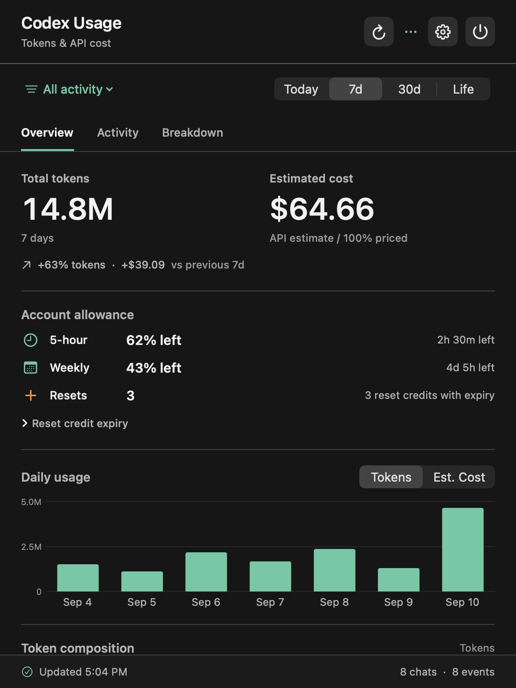
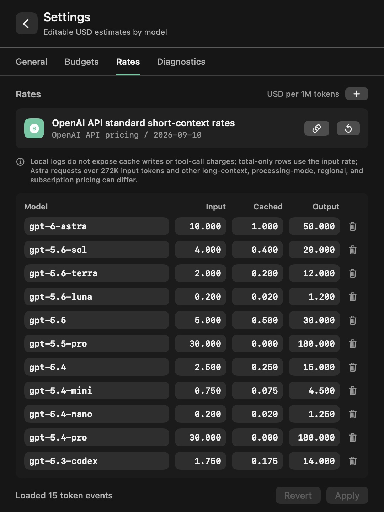

# Codex Usage Monitor

A native macOS menu-bar app for tracking local Codex tokens and estimated API costs, with optional Touch Bar controls.

[Download the latest release](https://github.com/Heaaaaaaaa/Codex-Usage-Monitor/releases/latest) | [Changelog](CHANGELOG.md)

<p align="center">
  
  
</p>
<p align="center"><sub>Synthetic demo data. No personal projects, chats, or logs are shown.</sub></p>

## Install

Requires **macOS 13 or later**, on Apple silicon or Intel.

1. Download [CodexUsageMonitor-0.5.2.dmg](https://github.com/Heaaaaaaaa/Codex-Usage-Monitor/releases/download/v0.5.2/CodexUsageMonitor-0.5.2.dmg).
2. Open the DMG and drag the app into **Applications**.
3. Launch it, then click its menu-bar icon. Logs are read from `~/.codex` by default; change the folder in Settings if needed.

**Signing:** Community builds are ad-hoc signed, not Developer ID signed or notarized. macOS may block the first launch with an unidentified-developer warning. Only open a download you trust; signing details and checksums are included with each release.

## Features

- Token totals and estimated USD cost for Today, 7 days, 30 days, or lifetime.
- Filters by project, chat, and model, with daily trends and previous-period comparisons.
- Separate non-cached input, cached input, output, and reasoning totals.
- Automatic official pricing updates, including GPT-6.1 Sol, with editable custom rates.
- Token/cost budgets, optional notifications, and locally reported usage-limit snapshots.
- CSV export, settings import/export, launch at login, and light/dark appearance.
- Compact menu-bar display and optional Touch Bar summary, refresh, and time filters.

## Pricing and Privacy

Costs use [OpenAI's Standard short-context API rates](https://developers.openai.com/api/docs/pricing). They are **API-equivalent estimates, not invoices or ChatGPT subscription charges**. Cache writes, tool charges, long-context multipliers, and other processing tiers are not included. Unknown or missing rates are marked as unpriced.

Automatic pricing checks are enabled by default and run at most daily while the app is open. They preserve custom rates and deleted rows, keep saved prices offline, and can be disabled in **Settings > Rates**. Estimates use the current catalog, not historical invoice prices.

Usage is calculated from local Codex logs. The app does not read authentication files, upload usage data, or collect analytics. Pricing checks fetch only OpenAI's public table; no API key is required. See the [Privacy Policy](PRIVACY.md) for network and local-storage details.

## Build from Source

Requires a Swift toolchain and macOS SDK, available through Xcode Command Line Tools.

```bash
make all OUT_DIR=build/output
open build/output/CodexUsageMonitor.app
make test verify-concurrency
```

See the [development and publishing guide](PUBLISHING.md) for demo data, benchmarks, packaging, verification, and notarization.

## Support

[Support](SUPPORT.md) | [Security](SECURITY.md) | [MIT License](LICENSE)
